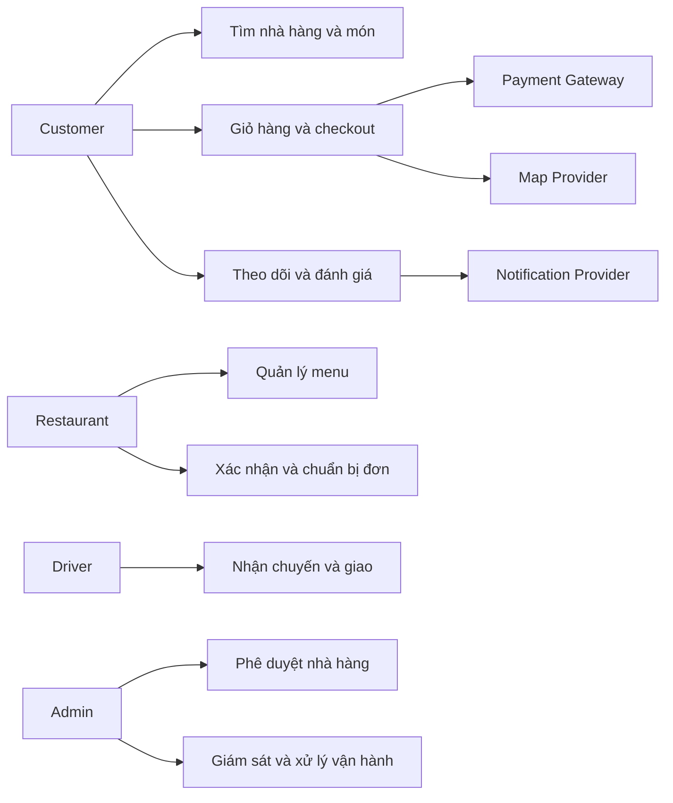
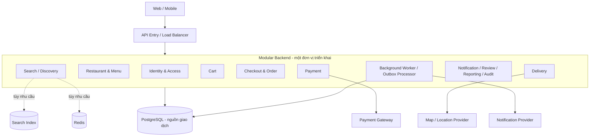
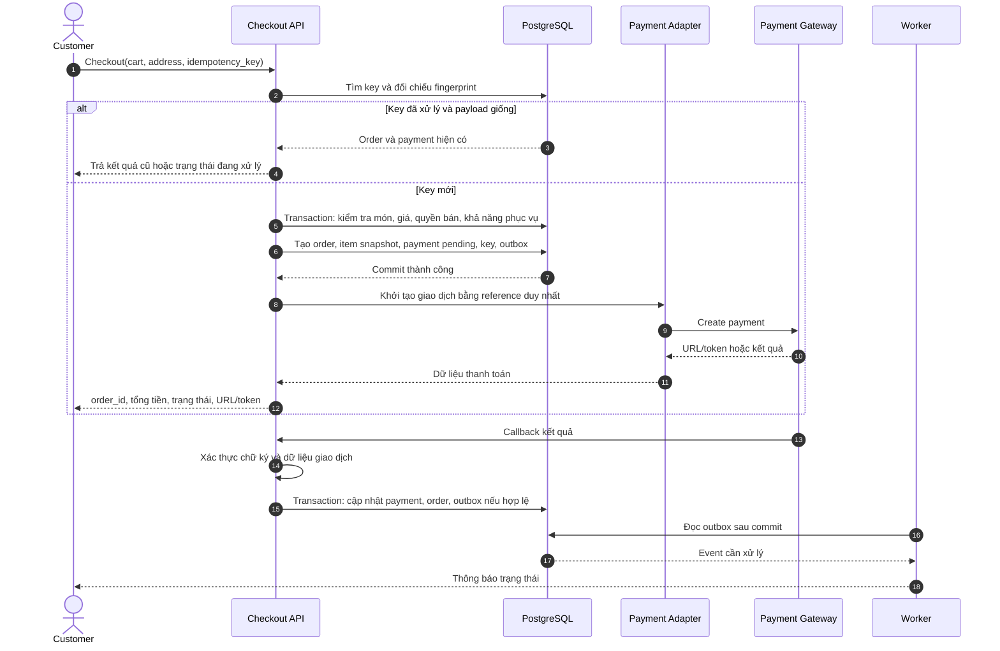
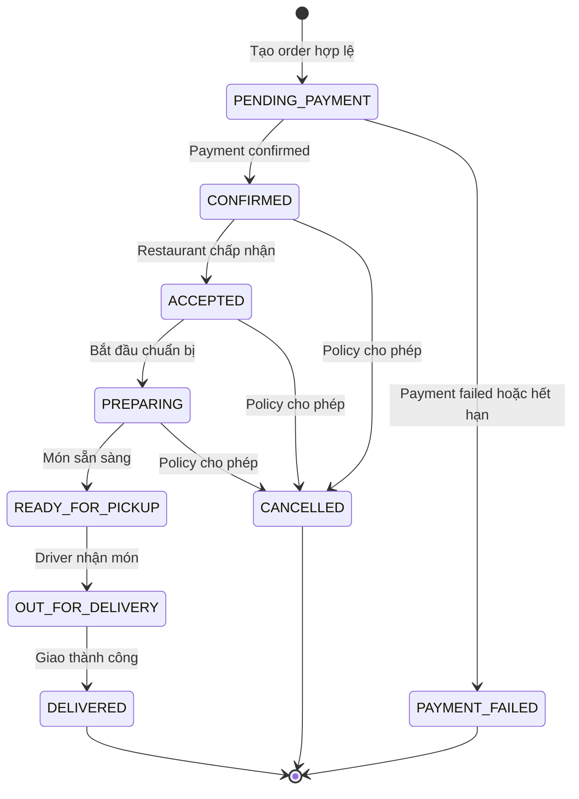
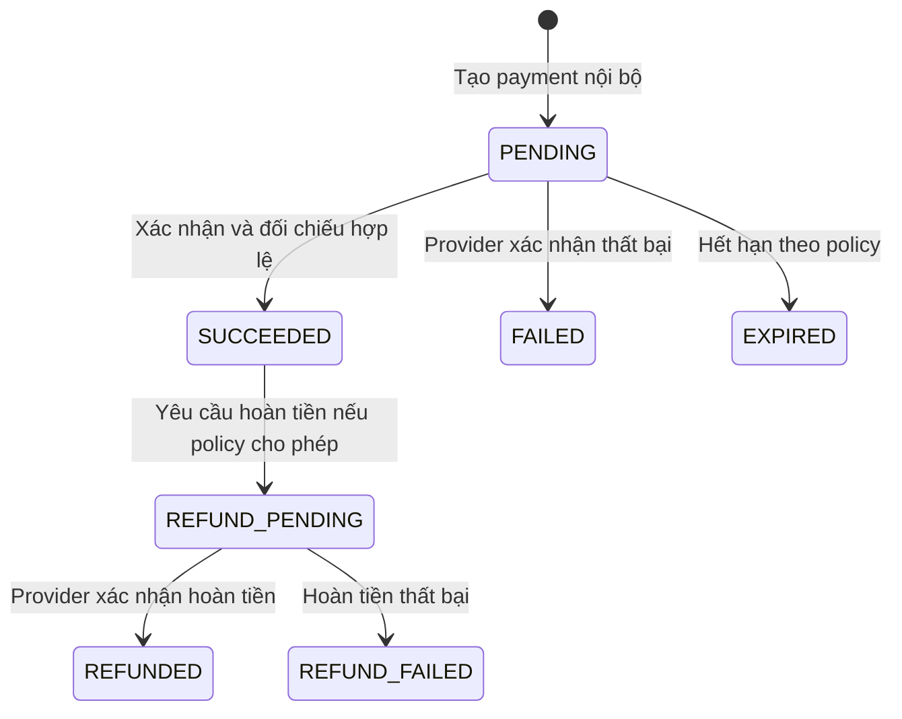
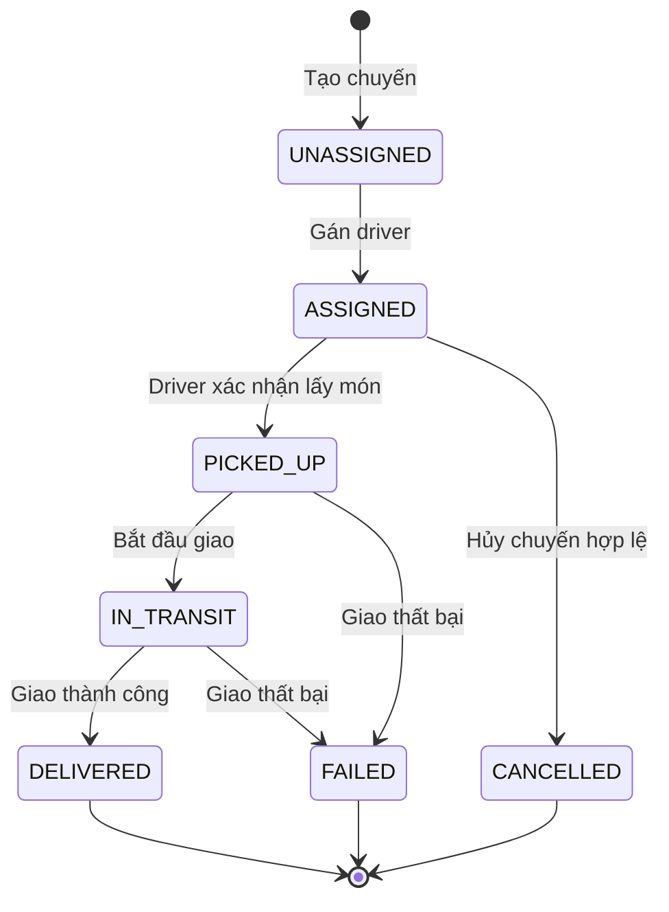
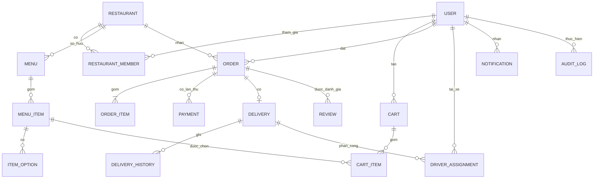

# Phân tích kiến trúc giai đoạn 1 cho nền tảng đặt đồ ăn trực tuyến

> **Trạng thái:** Đề xuất kiến trúc sơ bộ. Các chính sách nghiệp vụ và chỉ tiêu đánh dấu **cần xác nhận** chưa phải quyết định triển khai.
>
> **Nguồn:** Viết lại và mở rộng từ `Phase_1_Food_Delivery.docx` trong cùng thư mục.

## 1. Mục đích và kết luận sơ bộ

Tài liệu này là cơ sở để Product, Operations và nhóm kỹ thuật thống nhất phạm vi giai đoạn 1 trước khi thiết kế API, cơ sở dữ liệu và kế hoạch triển khai. Nền tảng phục vụ bốn nhóm người dùng: khách hàng, nhà hàng, tài xế và quản trị viên. Hệ thống cũng kết nối với nhà cung cấp thanh toán, bản đồ và thông báo.

**Đề xuất khởi đầu:** triển khai một **modular monolith**, dùng PostgreSQL làm nguồn dữ liệu giao dịch chính. Tách module và quyền sở hữu dữ liệu ngay trong ứng dụng; chỉ thêm Redis, công cụ tìm kiếm hoặc message broker khi số liệu tải và yêu cầu vận hành cho thấy cần thiết. Việc tách thành microservices là quyết định sau, dựa trên nhu cầu triển khai hoặc mở rộng độc lập.

Các điểm cần chốt trước thiết kế chi tiết gồm: một hay nhiều nhà hàng mỗi lần thanh toán, cách quản lý số suất/công suất, thời hạn thanh toán, hợp đồng với payment provider, chính sách hủy/hoàn tiền và cách gán tài xế. Chưa có các quyết định này thì không nên coi state machine hoặc tiêu chí nghiệm thu dưới đây là đặc tả cuối cùng.

### 1.1. Mục tiêu giai đoạn 1

1. Xác định actor, chức năng, quy tắc nghiệp vụ và ranh giới quyền truy cập.
2. Mô tả luồng tìm kiếm, giỏ hàng, checkout, thanh toán, xử lý đơn và giao hàng.
3. Chọn ranh giới module và mô hình dữ liệu khái niệm.
4. Đặt ra các kịch bản kiểm chứng về tính nhất quán, retry, phân quyền, hiệu năng và phục hồi.
5. Ghi lại quyết định sơ bộ cùng các câu hỏi cần xác nhận.

### 1.2. Phạm vi

| Trong phạm vi đề xuất | Để giai đoạn sau hoặc cần quyết định riêng |
|---|---|
| Tài khoản Customer, Restaurant, Driver, Admin; nhà hàng đăng ký và được phê duyệt | KYC pháp lý, thuế và đối soát nâng cao |
| Menu, món, lựa chọn, giá và trạng thái bán | Quảng cáo, cá nhân hóa, ranking nâng cao |
| Giỏ hàng, checkout, phí giao hàng, đơn hàng và thanh toán online | Ví nội bộ, trả góp, đa tiền tệ |
| Phân công và theo dõi giao hàng; thông báo và báo cáo cơ bản | Tối ưu tuyến đường, phân tích kinh doanh nâng cao |
| Đánh giá sau đơn hoàn thành; quản trị và audit | Quy trình khiếu nại, hoàn tiền nâng cao |

## 2. Actor và quyền hạn

| Actor | Tác vụ chính | Ranh giới quyền |
|---|---|---|
| Customer | Tìm món, quản lý giỏ, đặt và thanh toán, theo dõi, đánh giá | Chỉ xem/sửa dữ liệu và đơn của chính mình |
| Restaurant member | Quản lý nhà hàng, menu và đơn thuộc nhà hàng được cấp quyền | Kiểm tra quan hệ `user_id`–`restaurant_id` ở backend, không chỉ kiểm tra nhãn role |
| Driver | Xem chuyến được gán, xác nhận lấy món và cập nhật giao hàng | Chỉ thao tác trên assignment còn hiệu lực của mình |
| Admin | Phê duyệt nhà hàng, xử lý vận hành và nội dung vi phạm | Giới hạn theo quyền quản trị; ghi audit cho thao tác nhạy cảm |
| Payment Gateway | Tạo giao dịch, callback, tra cứu kết quả | Callback phải được xác thực và đối chiếu reference, số tiền, trạng thái |
| Map/Location Provider | Địa chỉ, khoảng cách, thời gian dự kiến | Chỉ truyền dữ liệu cần thiết |
| Notification Provider | Email, SMS hoặc push | Chỉ truyền dữ liệu tối thiểu phục vụ thông báo |

**Nguyên tắc bắt buộc:** client có thể gửi `restaurant_id`, `order_id` hoặc `delivery_id` để định danh tài nguyên, nhưng backend phải tự kiểm tra quyền với tài nguyên đó. Một role `Restaurant` chung không chứng minh người dùng thuộc nhà hàng đang được truy cập.

## 3. Giả định, quyết định sơ bộ và điểm chưa chốt

| Chủ đề | Cách hiểu dùng cho bản thiết kế sơ bộ | Việc cần xác nhận |
|---|---|---|
| Giỏ hàng | Một giỏ và một checkout phục vụ một nhà hàng. Điều này giữ đơn, thanh toán và phí giao hàng đơn giản trong giai đoạn đầu. | Có yêu cầu thanh toán nhiều nhà hàng trong một lần không? Nếu có, cần parent order, suborder và quy tắc chia phí/tiền. |
| Giá | Server tính lại giá món, option, khuyến mại và phí giao ở checkout; order item lưu snapshot. | Chính sách giá khi thay đổi trong lúc khách xác nhận; hiệu lực mã giảm giá. |
| Khả năng bán | Nhà hàng đã được duyệt và món ở trạng thái đang bán mới được checkout. | Có quản lý tồn theo suất hoặc giới hạn công suất theo khung giờ không? Trạng thái đang bán **không đủ** để chứng minh còn suất cuối. |
| Thanh toán | Thanh toán online thành công mới mở đơn cho nhà hàng xử lý; hệ thống giữ reference và trạng thái nội bộ. | Thời hạn pending, khả năng idempotency/query/callback ký số của provider, quy tắc với kết quả đến muộn. |
| Giao hàng | Delivery có vòng đời riêng và gắn với một order. | Gán tự động hay thủ công; cách xử lý khi không có tài xế. |
| Hủy đơn | Chỉ hủy ở trạng thái được policy cho phép; hủy sau thanh toán có thể cần hoàn tiền. | Ai được hủy, mốc thời gian, phí và quy trình refund. |
| Chỉ tiêu vận hành | Các SLO ở mục 8 là mục tiêu tham khảo. | Lưu lượng, vùng phục vụ, thời gian đo, RPO/RTO và phụ thuộc provider. |

Nếu Product chọn checkout nhiều nhà hàng, nhiều phần của tài liệu phải thay đổi cùng lúc: giao dịch thu tiền, phí giao, quyền sở hữu đơn, hoàn tiền từng phần, giao hàng và báo cáo. Không nên chỉ thay đổi cấu trúc giỏ hàng.

## 4. Yêu cầu chức năng và quy tắc nghiệp vụ

### 4.1. Chức năng theo module

| Module | Chức năng giai đoạn 1 | Điều kiện quan trọng |
|---|---|---|
| Identity & Access | Đăng ký, đăng nhập, hồ sơ, quyền theo tài nguyên | Xác thực và kiểm tra ownership ở mọi API liên quan |
| Restaurant & Menu | Đăng ký, phê duyệt, cập nhật nhà hàng; CRUD menu, món, option và giá | Nhà hàng chưa duyệt không nhận đơn; dữ liệu thuộc đúng nhà hàng |
| Search / Discovery | Tìm, lọc và sắp xếp nhà hàng/món | Kết quả tìm kiếm có thể trễ; checkout luôn xác minh lại |
| Cart | Thêm, sửa, xóa món và lựa chọn | Ràng buộc một nhà hàng theo phương án sơ bộ; không coi giá trong giỏ là giá cuối |
| Checkout & Order | Kiểm tra giỏ, địa chỉ, phí, giá; tạo đơn; theo dõi và xử lý đơn | Idempotency, transaction, snapshot và state transition |
| Payment | Tạo giao dịch, nhận callback, truy vấn/đối soát | Xác thực provider, reference duy nhất, xử lý callback lặp |
| Delivery | Tạo chuyến, gán tài xế, cập nhật trạng thái | Kiểm tra assignment và ghi lịch sử |
| Review & Complaint | Đánh giá đơn hoàn thành, ghi nhận khiếu nại cơ bản | Chỉ người mua hợp lệ được đánh giá; quy trình khiếu nại chi tiết còn mở |
| Notification | Gửi sự kiện liên quan đến đơn và giao hàng | Gửi bất đồng bộ, retry có giới hạn, không làm sai giao dịch chính |
| Reporting & Audit | Thống kê cơ bản; lưu hành động nhạy cảm | Định nghĩa rõ nguồn số liệu và thời điểm ghi nhận |

### 4.2. Quy tắc nghiệp vụ cốt lõi

| Mã | Quy tắc | Cách kiểm chứng |
|---|---|---|
| BR1 | Chỉ món đang bán của nhà hàng đã duyệt được checkout. | Ngừng bán trước checkout thì toàn bộ checkout thất bại. |
| BR2 | Giá, option, khuyến mại và phí giao cuối cùng do server tính. | Sửa giá trong request không làm thay đổi tổng tiền. |
| BR3 | Một restaurant order thuộc đúng một nhà hàng. | Không có item của nhà hàng khác trong order đó. |
| BR4 | Một payment reference chỉ được xác nhận thành công một lần. | Callback lặp không nhân đôi tác động. |
| BR5 | Chỉ cho phép chuyển trạng thái order, payment và delivery theo quy tắc. | API từ chối transition sai và giữ nguyên dữ liệu. |
| BR6 | Retry checkout cùng key và cùng payload trả lại cùng kết quả. | Không tạo thêm order; cùng key nhưng payload khác trả conflict. |
| BR7 | Restaurant và Driver chỉ thao tác trên tài nguyên được gán. | Thay ID của tài nguyên khác bị từ chối. |
| BR8 | Thao tác nhạy cảm của Admin/Restaurant được audit. | Có actor, hành động, tài nguyên, thời điểm và kết quả. |

### 4.3. Luồng chức năng điển hình

1. **Customer:** tìm nhà hàng/món → thêm giỏ → nhập địa chỉ → xem báo giá server → checkout → thanh toán → theo dõi → đánh giá nếu đơn hoàn thành.
2. **Restaurant:** đăng ký → được Admin phê duyệt → quản lý menu → nhận đơn đã đủ điều kiện xử lý → chấp nhận/từ chối theo policy → chuẩn bị → bàn giao.
3. **Driver:** nhận assignment → lấy món → cập nhật đang giao → xác nhận thành công/thất bại.
4. **Admin:** phê duyệt nhà hàng → giám sát → xử lý tình huống vận hành với audit.

## 5. Kiến trúc ứng dụng

### 5.1. Sơ đồ thành phần

Sơ đồ thể hiện **ranh giới logic**, không ngụ ý mỗi ô là một service độc lập. PostgreSQL giữ order, payment state và dữ liệu giao dịch có thẩm quyền. Cache và search index chỉ phục vụ đọc hoặc tăng tốc; chúng không quyết định giá cuối, quyền mua hoặc tính hợp lệ của đơn. Adapter cô lập hợp đồng của nhà cung cấp bên ngoài khỏi nghiệp vụ lõi.

### 5.2. Quyền sở hữu dữ liệu và phụ thuộc module

- Mỗi module định nghĩa API nội bộ và sở hữu bảng hoặc schema của mình. Module khác gọi qua API/domain contract; không ghi trực tiếp vào bảng thuộc module kia.
- Checkout điều phối việc xác minh menu, định giá, tạo order và khởi tạo payment. Các thay đổi cần nguyên tử trong PostgreSQL nằm trong một transaction ngắn.
- Việc gửi thông báo, cập nhật read model và báo cáo chạy sau commit qua outbox/worker. Worker phải chịu được xử lý lại cùng event.
- Một transaction DB không bao trùm cuộc gọi payment provider. Tình huống đã commit nhưng chưa gọi được provider cần cơ chế tiếp tục hoặc đối soát.
- Nếu tách module thành service sau này, cần xác định lại giao dịch xuyên ranh giới, event contract, độ trễ dữ liệu và trách nhiệm vận hành.

### 5.3. So sánh phương án kiến trúc

| Tiêu chí | Monolith ít ranh giới | Modular monolith | Microservices |
|---|---|---|---|
| Thời gian khởi đầu | Thường ngắn nhất | Trung bình | Cao hơn vì hạ tầng và hợp đồng phân tán |
| Giao dịch order nội bộ | Dễ dùng một DB transaction | Dễ dùng một DB transaction nếu ranh giới module rõ | Cần xử lý nhất quán giữa service |
| Tách trách nhiệm nghiệp vụ | Dễ bị phụ thuộc chéo | Rõ nhờ API và ownership | Rõ ở cấp triển khai nhưng cần quản trị contract |
| Triển khai | Một đơn vị | Một đơn vị | Nhiều đơn vị |
| Mở rộng độc lập | Hạn chế | Tối ưu đọc/worker trước; tách service khi cần | Có thể mở rộng riêng từng service |
| Độ phức tạp vận hành | Thấp ban đầu | Vừa phải | Cao: mạng, tracing, deployment, dữ liệu phân tán |
| Phù hợp hiện tại | Có thể nhanh nhưng khó giữ ranh giới | **Đề xuất** | Chưa có bằng chứng đủ mạnh để chọn ngay |

Đây là so sánh định tính, chưa phải phép đo hiệu năng hay chi phí. Chỉ cân nhắc tách service khi có số liệu cho thấy nhu cầu release độc lập, scaling độc lập, fault isolation hoặc ownership dữ liệu độc lập, và đã có kế hoạch migration.

## 6. Checkout và thanh toán

### 6.1. Hợp đồng đầu vào và đầu ra

Checkout nhận người dùng đã xác thực, giỏ hàng hoặc cart version, địa chỉ, lựa chọn giao và `idempotency_key`. Client có thể hiển thị tổng tiền dự kiến nhưng server tính lại toàn bộ. Kết quả gồm `order_id`, số tiền cuối, trạng thái order/payment và dữ liệu cần thiết để thanh toán. Cùng một key với cùng payload chuẩn hóa phải trả cùng order hoặc trạng thái đang xử lý; cùng key với payload khác là conflict.

Phạm vi duy nhất được đề xuất cho key là `(customer_id, idempotency_key)`. Cần lưu thêm fingerprint của payload, kết quả và thời hạn lưu phù hợp với cửa sổ retry. Unique constraint ở DB là lớp bảo vệ cuối cùng khi nhiều request đến đồng thời.

### 6.2. Trình tự xử lý

Chi tiết triển khai cần bảo đảm rằng nếu ứng dụng dừng sau DB commit nhưng trước hoặc trong lệnh `Create payment`, bản ghi pending được worker hoặc quy trình khôi phục tiếp tục xử lý. Việc retry lệnh tạo giao dịch với provider phải dựa vào khả năng idempotency thực tế của provider hoặc cơ chế tra cứu bằng reference; không giả định provider hỗ trợ sẵn.

### 6.3. Trường hợp lỗi và đối soát

| Tình huống | Xử lý đề xuất |
|---|---|
| Giá/option hoặc trạng thái món thay đổi trước checkout | Từ chối toàn bộ checkout hoặc trả báo giá mới để khách xác nhận; không tạo partial order. |
| Hai checkout cạnh tranh một suất có quản lý tồn | Dùng transaction với khóa/conditional update và constraint phù hợp; chỉ một request giành được suất. Redis lock đơn độc không bảo vệ dữ liệu giao dịch. |
| Client timeout sau khi tạo order | Retry cùng key đọc kết quả cũ; không tạo order thứ hai. |
| Provider timeout hoặc chưa rõ kết quả | Giữ payment pending; query/reconcile trước khi tạo giao dịch mới hoặc báo thất bại. |
| Callback trùng | Kiểm tra reference và trạng thái đã áp dụng; trả kết quả an toàn, không xác nhận lần hai. |
| Callback sai chữ ký hoặc sai số tiền/order | Từ chối, ghi sự kiện bảo mật và không cập nhật nghiệp vụ. |
| Callback thành công đến sau khi order hết hạn/hủy | Giữ dấu vết payment, đối soát và xử lý theo chính sách late payment/refund đã được phê duyệt; không tự mở lại order. |

**Khoảng trống cần giải quyết:** tài liệu gốc nêu kiểm thử “món cuối” nhưng mô hình `MENU_ITEM` chỉ có `sell_status`, chưa có tồn suất hoặc công suất theo khung giờ. Nếu nghiệp vụ cần cam kết không bán quá số lượng, phải thêm nguồn tồn/công suất có thẩm quyền, quy tắc giữ và nhả suất, thời hạn reservation, cùng ràng buộc DB trước khi nghiệm thu kịch bản này.

## 7. Vòng đời trạng thái

Order, Payment và Delivery có state machine riêng. Mỗi transition phải kiểm tra trạng thái hiện tại, điều kiện nghiệp vụ và quyền của actor; lưu `from_state`, `to_state`, actor, thời điểm, lý do/correlation ID. Client không được gửi một trạng thái tùy ý để ghi trực tiếp.

### 7.1. Order

Các nhánh `CANCELLED` là **điểm quyết định chính sách**, không mặc định mọi yêu cầu hủy ở các trạng thái đó đều được chấp nhận. Luồng nhà hàng từ chối đơn, giao thất bại và hoàn tiền cần được bổ sung sau khi có policy; sơ đồ hiện chưa suy diễn đích đến cho chúng.

### 7.2. Payment

Payment state machine này là **đề xuất bổ sung** để làm rõ nguyên tắc “order, payment, delivery độc lập” trong tài liệu gốc. `EXPIRED`, `REFUND_PENDING` và các trạng thái refund chỉ được dùng sau khi chốt hợp đồng provider và chính sách hủy. Cần lưu lịch sử giao dịch provider riêng nếu một order có nhiều payment attempt.

### 7.3. Delivery

Quy tắc gán lại tài xế, giao thất bại rồi thử lại, và đồng bộ kết quả delivery với order còn cần Operations xác nhận. Không nên tự động suy ra order `DELIVERED` chỉ từ một thông điệp delivery chưa xác thực hoặc bị gửi lặp.

## 8. Mô hình dữ liệu khái niệm

ERD dùng `ORDER` gắn trực tiếp một `RESTAURANT`, phù hợp với phương án một nhà hàng mỗi checkout. Nếu chọn multi-restaurant, cần thêm parent order và restaurant suborder; không dùng một `ORDER` thuộc nhiều nhà hàng mà vẫn áp dụng quy tắc ownership hiện tại.

| Entity | Dữ liệu cần giữ |
|---|---|
| `USER`, `RESTAURANT`, `RESTAURANT_MEMBER` | Danh tính, trạng thái tài khoản/nhà hàng, quan hệ thành viên và quyền theo nhà hàng |
| `MENU`, `MENU_ITEM`, `ITEM_OPTION` | Danh mục, món, option, giá hiện hành, trạng thái bán |
| `CART`, `CART_ITEM` | Chủ giỏ, nhà hàng, số lượng và lựa chọn tạm thời; không phải nguồn giá cuối |
| `ORDER`, `ORDER_ITEM` | Khách, nhà hàng, tổng tiền, tiền tệ, trạng thái; giá và option snapshot tại lúc đặt |
| `PAYMENT` | Order, reference, external transaction ID, amount, status, thời điểm và thông tin đối soát |
| `DELIVERY`, `DELIVERY_HISTORY`, `DRIVER_ASSIGNMENT` | Địa chỉ, phí, trạng thái, lịch sử và quan hệ gán tài xế |
| `NOTIFICATION`, `REVIEW`, `AUDIT_LOG` | Trạng thái gửi, đánh giá hợp lệ và dấu vết thao tác |

Ràng buộc tối thiểu: foreign key cho quan hệ; unique `(customer_id, idempotency_key)` và payment reference; check số lượng/giá hợp lệ; một delivery cho mỗi order nếu nghiệp vụ yêu cầu; index theo `restaurant_id`, `customer_id`, `order_id` và trạng thái truy vấn thường dùng. Cần quyết định chính xác khả năng một order có nhiều payment attempt trước khi chốt unique constraint cho `PAYMENT.order_id`. Điều kiện “restaurant đã duyệt” và “món đang bán” phụ thuộc dữ liệu hiện hành nên phải được kiểm tra trong nghiệp vụ/transaction, không chỉ bằng foreign key.

## 9. Chất lượng hệ thống, bảo mật và vận hành

### 9.1. Mục tiêu cần xác nhận

| Thuộc tính | Mục tiêu hoặc cách tiếp cận sơ bộ | Dữ liệu còn thiếu |
|---|---|---|
| Performance | p95 request xem món/nhà hàng dưới 2 giây ở tải bình thường | RPS, payload, thiết bị, vùng địa lý, điều kiện đo |
| Availability | 99,9% cho luồng browse/order | Cửa sổ đo, lịch bảo trì, cách tính sự cố provider |
| Scalability | Tăng application instance mà không phụ thuộc session trong memory | Peak traffic, order/giây, tỷ lệ tải đỉnh |
| Consistency | Không duplicate order/payment; không oversell nếu có tồn/công suất | Mô hình tồn, transaction, isolation và reservation |
| Reliability | Retry/callback và worker xử lý lặp an toàn | Hợp đồng idempotency của provider, retry policy |
| Security | AuthN, AuthZ theo tài nguyên, mã hóa đường truyền | Chi tiết role, lưu dữ liệu cá nhân, retention |
| Observability | Theo dõi request, order, payment, delivery | Quy ước ID, dashboard, cảnh báo và nơi lưu log |
| Recovery | Backup PostgreSQL và diễn tập restore | RPO, RTO, tần suất backup, môi trường dự phòng |

Không coi những con số sơ bộ là SLO chính thức cho đến khi xác định cách đo và phụ thuộc vào nhà cung cấp bên ngoài.

### 9.2. Kiểm soát bảo mật

- Dùng session/JWT phù hợp với cách triển khai; mọi API nhạy cảm kiểm tra xác thực, role **và** ownership tài nguyên.
- Dùng TLS; lưu secrets ngoài mã nguồn, phân quyền truy cập và luân chuyển theo quy trình vận hành.
- Callback thanh toán cần xác minh chữ ký theo đặc tả provider, chống replay theo reference/event ID và đối chiếu amount, currency, order.
- Giới hạn tốc độ cho đăng nhập, checkout và callback theo nguồn hợp lý; tránh để rate limit làm mất callback hợp lệ mà không có cơ chế retry/đối soát.
- Audit hành động phê duyệt, thay đổi giá, xử lý đơn thủ công, quyền tài khoản và quyết định khiếu nại. Không ghi thông tin thanh toán hoặc dữ liệu cá nhân không cần thiết vào log.

### 9.3. Quan sát và phục hồi

Log và trace nên chứa correlation ID cùng `order_id`, `payment_id` hoặc `delivery_id` khi phù hợp. Metric tối thiểu gồm p95/p99, tỷ lệ lỗi checkout, payment pending quá hạn, callback bị từ chối/trùng, delivery failure, độ dài hàng đợi/outbox và độ trễ worker. Cần cảnh báo khi reconciliation bị tồn đọng. Backup chỉ có giá trị khi đã thử khôi phục và đo được thời gian phục hồi thực tế.

## 10. Rủi ro và kịch bản kiểm chứng

| Rủi ro | Cơ chế bảo vệ/kiểm chứng |
|---|---|
| Cạnh tranh suất cuối | Xác định nguồn tồn/công suất; transaction và conditional update/locking; kiểm tra chỉ một checkout thành công. |
| Retry checkout | Key và fingerprint lưu cùng kết quả; kiểm tra cùng key không sinh order mới, payload khác trả conflict. |
| Callback trùng/sai/đến muộn | Verify và đối chiếu; unique reference, transition idempotent, reconciliation theo policy. |
| Provider chậm hoặc mất kết nối | Timeout có giới hạn, trạng thái pending, query kết quả, tiếp tục xử lý sau crash. |
| Truy cập chéo nhà hàng/tài xế | Kiểm tra membership/assignment ở backend trên mọi đường đọc và ghi; kiểm thử đổi ID. |
| Traffic tăng đột biến | Load test discovery và checkout; đo DB, cache hit, queue backlog, latency, error rate. |
| Search/cache trễ | Checkout đọc dữ liệu giao dịch có thẩm quyền và tính lại giá/khả năng bán. |
| Transition sai hoặc xử lý lặp | Cập nhật có điều kiện theo trạng thái hiện tại và ghi history trong transaction. |

### 10.1. Tiêu chí nghiệm thu kiến trúc

1. **Concurrent checkout:** với nguồn tồn/công suất đã được định nghĩa và còn đúng một suất, hai checkout đồng thời chỉ có tối đa một checkout chiếm suất; không có số âm. Nếu giai đoạn 1 không quản lý suất, phải bỏ hoặc viết lại phép thử này theo cam kết thực tế.
2. **Checkout retry:** cùng khách, key và payload trả cùng order/trạng thái; cùng key với payload khác trả conflict.
3. **Payment callback:** callback hợp lệ lặp không xác nhận hai lần; callback sai chữ ký hoặc sai dữ liệu bị từ chối và ghi log phù hợp.
4. **Late payment:** callback đến sau khi order hết hạn/hủy không tự mở lại đơn; có bản ghi để đối soát và xử lý theo policy.
5. **Cross-restaurant access:** Restaurant A không đọc/sửa order của B; API trả 403 hoặc 404 theo chính sách che giấu tài nguyên, không rò dữ liệu.
6. **Driver authorization:** Driver không cập nhật delivery ngoài assignment còn hiệu lực.
7. **Invalid transition:** API từ chối, trạng thái và history không bị thay đổi sai.
8. **Provider timeout/crash window:** không mất dấu order/payment pending; quy trình tiếp tục hoặc đối soát không nhân đôi giao dịch.
9. **Traffic spike:** đo latency, error, DB utilization và queue backlog; tính đúng đắn của checkout vẫn được giữ.
10. **Multi-restaurant:** chỉ áp dụng nếu được chấp thuận; mỗi suborder thuộc đúng một restaurant, phí/thanh toán/hoàn tiền có quy tắc nhất quán.

## 11. Câu hỏi mở và thứ tự ra quyết định

### P0 — chặn thiết kế chi tiết

1. Một checkout có thể chứa nhiều nhà hàng không? Nếu có, ai thu tiền, phân bổ phí giao và hoàn tiền từng phần thế nào?
2. Có giới hạn tồn suất hoặc công suất theo thời gian không? Nếu có, khi nào giữ và nhả suất?
3. Payment pending giữ bao lâu? Khi hết hạn nhưng provider báo thành công muộn thì xử lý ra sao?
4. Provider hỗ trợ idempotency key, query transaction, signed callback, refund và mã sự kiện duy nhất ở mức nào?
5. Ai được hủy hoặc từ chối đơn ở từng trạng thái, phí và refund tương ứng là gì?
6. Gán tài xế tự động hay thủ công; xử lý không có tài xế và giao thất bại thế nào?

### P1 — chốt trước kế hoạch tải và vận hành

1. Số người dùng, nhà hàng, món, đơn/giây, tỷ lệ peak và vùng địa lý dự kiến?
2. Availability, RPO, RTO và cửa sổ đo được doanh nghiệp chấp nhận?
3. Công thức phí giao, phụ phí, promotion và thứ tự áp dụng?
4. Địa chỉ, vị trí và dữ liệu cá nhân được lưu bao lâu; ai có quyền xem?
5. Tải tìm kiếm, tần suất cập nhật menu và độ trễ chấp nhận được có biện minh cho search index/cache/broker ngay giai đoạn đầu không?

### 11.1. Đầu ra tiếp theo sau khi chốt P0/P1

- Đặc tả API và lỗi nghiệp vụ cho checkout, payment callback, order và delivery.
- Schema vật lý, index, constraint, transaction boundary và kế hoạch migration.
- Bảng transition đầy đủ kèm actor, điều kiện, side effect và policy hủy/hoàn tiền.
- Hợp đồng adapter với provider, quy trình reconciliation, retry và xử lý sự cố.
- Kế hoạch kiểm thử tải, bảo mật, backup/restore và tiêu chí nghiệm thu có thể đo được.
