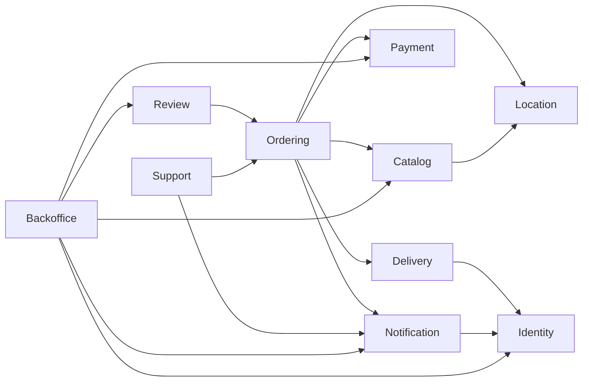

# Đối sánh thiết kế Phase 2 với codebase hiện tại

Ngày đánh giá: 12/11/2026.

Kết luận: codebase đã có nền tảng đặt món, tồn suất, thanh toán mô phỏng, chuẩn bị món, giao hàng được gán thủ công và quản trị cơ bản. Ba trọng tâm mở rộng trong tài liệu có mức độ khác nhau: **Automatic Driver Assignment chưa được triển khai; Realtime Delivery Tracking chưa được triển khai; Exception Management mới có một phần**. Redis/SSE, bảng assignment và trạng thái giao thất bại hiện có chưa đủ để kết luận các workflow mới đã hoàn thành.

## 1. Phạm vi và cách đánh giá

Hai tài liệu đầu vào:

- [Thiết kế kiến trúc và chức năng theo role](SA_Food_Delivery_Architecture_and_Role_Design.docx), đặc biệt các mục 4–11.
- [AI Coding Master Prompt](SA_Food_Delivery_AI_Coding_Master_Prompt.md), đặc biệt các mục 3–14.

Đối tượng đối sánh là working tree trên nhánh `feat/notification-sse`, commit `acbb8df`. So sánh `main...HEAD` chỉ có khác biệt ở `tests/migration-safety.test.ts`; source ứng dụng của hai nhánh giống nhau tại thời điểm đánh giá. Hai tài liệu đầu vào đang là file chưa được Git theo dõi.

Đã đọc schema Prisma, migration SQL, routes, services, repositories, public API/ports/events, worker, frontend và các test liên quan. Không dùng README làm bằng chứng triển khai. Không thay đổi source, migration, API hoặc `.env`; file báo cáo này là đầu ra duy nhất được bổ sung.

Quy ước:

- **Đã hoàn thiện:** phần chức năng được nêu cụ thể đã có đường xử lý trong source. Đây không phải chứng nhận đã nghiệm thu production.
- **Hoàn thiện một phần:** đã có một hoặc nhiều thành phần nhưng thiếu hành vi, phạm vi quyền, dữ liệu hoặc giao diện theo yêu cầu mới.
- **Chưa thực hiện:** chưa có workflow tương ứng trong source; có hạ tầng có thể tái sử dụng không làm thay đổi kết luận này.

Các mục được tài liệu coi là tùy chọn/giai đoạn sau vẫn được ghi nhận, nhưng không tính là điều kiện chặn nghiệm thu Phase 1. Không quy đổi số dòng checklist thành phần trăm tiến độ vì độ lớn và mức ưu tiên của từng mục khác nhau.

## 2. Kiến trúc và dependency thực tế

Có 10 module nghiệp vụ; chưa có module Assignment. Audit là shared capability, phù hợp phương án tài liệu cho phép.

Sơ đồ thể hiện import giữa module, gồm cả type import. Payment và Delivery nhận gateway do Ordering triển khai; composition root nối gateway và event handlers. Các event tác động ngược về Ordering qua subscription, không tạo import cycle. Xem [composition root](../../server/modules/index.ts), [event contracts](../../server/shared/events.ts) và [kiểm tra ranh giới module](../../tests/module-boundaries.test.ts).

Các module lớn có application/domain/infrastructure; các module nhỏ giữ cấu trúc phẳng. Map có provider interface và adapter; Payment có adapter create/query/refund, nhưng implementation hiện tại là simulator. Reporting và order detail dùng projection/read query qua bảng module khác. Đây là ngoại lệ có chủ đích, không phải lý do tạo thêm repository hoặc read model trùng chức năng.

## 3. Những phần đã hoàn thiện trong phạm vi chức năng hiện có

| Yêu cầu đối chiếu | Bằng chứng và hành vi đã có |
|---|---|
| Giữ Modular Monolith, public API, graph không cyclic | Module giao tiếp qua `index.ts`; có port, domain event, repository và projection. Cả 5 test ranh giới module pass. [Nguồn](../../tests/module-boundaries.test.ts) |
| Identity với bốn role, đăng ký/đăng nhập/session/profile cơ bản | Role CUSTOMER/RESTAURANT/DRIVER/ADMIN; Driver đăng ký ở trạng thái chờ kích hoạt; session lưu DB; profile sửa tên. [Nguồn](../../server/modules/identity/identity.service.ts) |
| Customer khám phá nhà hàng, chọn món/extras, giỏ một nhà hàng | Search/list/detail, giỏ có version, giá server tính lại, lưu snapshot món/options khi tạo đơn. [Nguồn](../../server/modules/catalog/application/catalog.service.ts), [checkout](../../server/modules/ordering/application/checkout.ts) |
| Restaurant CRUD món, giá, ảnh, extras; bật/tắt bán và hiển thị món | Backend kiểm tra membership; extras lưu JSON được validate, không cần bảng `ItemOption` riêng chỉ để khớp tên entity. Có form tương ứng. [Service](../../server/modules/catalog/application/catalog.service.ts), [form](../../src/components/Workspace.tsx) |
| Tạm dừng nhận đơn, ẩn/soft archive nhà hàng và món | `accepting_orders`, `catalog_visible`, `visible`, `available`; checkout từ chối nhà hàng/món không đủ điều kiện. Không xóa lịch sử đơn. [Nguồn](../../server/modules/catalog/application/catalog.service.ts) |
| Chuỗi chuẩn bị món của Restaurant | Backend chỉ cho `CONFIRMED → ACCEPTED → PREPARING → READY_FOR_PICKUP`, kiểm tra đơn thuộc nhà hàng. [Policy](../../server/modules/ordering/domain/order-status.ts), [service](../../server/modules/ordering/application/order-lifecycle.ts) |
| Chuỗi cập nhật giao hàng thông thường | Driver được gán có thể đi từ `ASSIGNED → PICKED_UP → IN_TRANSIT → DELIVERED`; sai transition bị từ chối. Pickup bắt buộc Order `READY_FOR_PICKUP`. [Nguồn](../../server/modules/delivery/application/delivery.service.ts) |
| Phân quyền tài nguyên cho Order và Delivery hiện có | Customer chỉ đơn mình; Restaurant theo membership; Driver theo assignment active. Restaurant không gọi được API assign hoặc transition delivery; Driver không sửa trạng thái chuẩn bị món. [Order access](../../server/modules/ordering/application/order-queries.ts), [delivery routes](../../server/modules/delivery/delivery.routes.ts) |
| Chặn Restaurant tự thay đổi sau pickup trong luồng hiện có | Restaurant chỉ có các bước chuẩn bị; cancellation chỉ trước acceptance; không có quyền cập nhật delivery. Policy hiện tại còn hạn chế hơn mốc sau pickup. [Nguồn](../../server/modules/ordering/application/order-lifecycle.ts) |
| Customer đánh giá đơn đã giao và gửi khiếu nại của mình | Review yêu cầu `DELIVERED`, mỗi order một review; complaint kiểm tra ownership. Admin xử lý complaint có audit và notification. [Review](../../server/modules/review/review.service.ts), [support](../../server/modules/support/support.service.ts) |
| Admin kiểm duyệt review, giữ nội dung và lịch sử thao tác | Hide/unhide giữ nguyên bản ghi review; audit ghi actor, resource, thời điểm và giá trị hidden. Đáp ứng phần giữ nội dung và lịch sử ở mức cơ bản; tài liệu không bắt buộc một bảng moderation riêng. [Nguồn](../../server/modules/review/review.service.ts) |
| Cơ chế notification inbox + outbox + Redis/SSE cơ bản | Enqueue trong business transaction; worker claim bằng `SKIP LOCKED`, chống duplicate notification, giới hạn retry; publish sau commit; SSE theo user, có reconnect/replay và giới hạn kết nối. Redis là tùy chọn. [Worker](../../server/modules/notification/notification.service.ts), [repository](../../server/modules/notification/notification.repository.ts), [SSE](../../server/modules/notification/notification.stream.ts) |

Lưu ý: “phân quyền tài nguyên hiện có” và “notification cơ bản” không bao gồm offer, assignment tự động hoặc GPS chưa tồn tại. Chưa thể nghiệm thu toàn bộ yêu cầu AuthZ/notification của thiết kế mới chỉ từ các phần này.

## 4. Những phần mới hoàn thiện một phần

| Hạng mục | Đã có | Thiếu hoặc khác thiết kế mục tiêu |
|---|---|---|
| Hồ sơ Restaurant | Tên, mô tả, địa chỉ, cuisine, ảnh, tọa độ và trạng thái nhận đơn | `phone`, `opening_hours` có trong schema và màn hình xem, nhưng không có trong create/patch schema hoặc form quản lý. Chưa có cơ chế mở/đóng theo lịch. [Service](../../server/modules/catalog/application/catalog.service.ts), [form](../../src/components/Workspace.tsx) |
| CRUD nhóm món/menu | Có `Menu`, item có category, upsert nhóm khi thêm/chuyển món | Chưa có workflow CRUD nhóm độc lập như đổi tên/xóa nhóm. Không nên kết luận “CRUD menu đầy đủ” từ CRUD món. [Menu repository](../../server/modules/catalog/infrastructure/menu.repository.ts) |
| Quản lý tồn kho | `stock` theo suất; checkout khóa và reserve; failure/expiry/cancel hợp lệ release một lần; DB cấm stock âm | Chưa có `StockMovement`, nhập/xuất/điều chỉnh dạng ledger, low-stock alert hoặc tự đổi cờ `available`/`visible` khi stock về 0. UI và checkout đã chặn mua khi hết suất. [Catalog](../../server/modules/catalog/application/catalog.service.ts), [stock release](../../server/modules/ordering/application/order-lifecycle.ts) |
| Restaurant từ chối đơn có lý do | Có cancel kèm reason trước acceptance, gọi được bởi Restaurant sở hữu đơn | Dùng chung `CANCELLED`; chưa có luồng từ chối riêng hay chính sách sau acceptance. Không phải hoàn toàn chưa có khả năng từ chối. [Routes](../../server/modules/ordering/ordering.routes.ts), [cancel](../../server/modules/ordering/application/order-lifecycle.ts) |
| Restaurant theo dõi Driver | Order detail có tên Driver, trạng thái và timeline | Chưa có mốc Driver đến quán, GPS hoặc bản đồ tracking. [Projection](../../server/modules/ordering/infrastructure/order-detail.projection.ts), [UI](../../src/components/Orders.tsx) |
| Restaurant dashboard/doanh thu/lịch sử | Có list đơn theo membership, tổng đơn/giao thành công/thất bại/doanh thu và báo cáo ngày | Chưa có báo cáo hiệu suất sâu. “Revenue” hiện là tổng giá trị đơn đã giao, bao gồm phí ship, chưa phải tiền thực nhận của Restaurant. [Report](../../server/modules/backoffice/report.repository.ts), [định nghĩa chỉ số](../../server/modules/backoffice/report.service.ts) |
| Restaurant xem/phản hồi review | Xem review công khai; order detail có review | Chưa có reply, yêu cầu kiểm duyệt hoặc lịch sử trao đổi. [Review routes](../../server/modules/review/review.routes.ts), [catalog detail](../../server/modules/catalog/application/catalog.service.ts) |
| Driver xem thông tin chuyến | Có nhà hàng, địa chỉ khách, snapshot món, note, delivery fee, tên Driver và timeline | Order detail chỉ join tên nhà hàng, chưa có địa chỉ pickup trong response này; chưa có giao diện điều hướng đến quán/khách. [Projection](../../server/modules/ordering/infrastructure/order-detail.projection.ts), [UI](../../src/components/Orders.tsx) |
| Driver history | `/orders` trả các đơn có assignment active của Driver, gồm cả đơn đã hoàn thành do assignment chưa được đóng | Chưa có API/trang lịch sử riêng, filter/pagination hoặc báo cáo thu nhập/performance; hiện giới hạn 100 đơn. Cần bảo toàn history khi sửa lifecycle assignment. [Projection](../../server/modules/ordering/infrastructure/order-detail.projection.ts) |
| Admin duyệt nhà hàng, kích hoạt/khóa tài khoản | Có APPROVED/REJECTED, active true/false; khóa tài khoản xóa session; có audit | Chưa bắt buộc reason khi khóa theo yêu cầu thiết kế; chưa có policy xử lý offer/chuyến đang active khi khóa Driver. Approval hiện lưu quyết định, chưa có giải trình bổ sung. [Admin](../../server/modules/backoffice/admin.service.ts), [approval](../../server/modules/catalog/application/catalog.service.ts) |
| Admin xem/lọc đơn và monitoring | Xem toàn hệ thống; trạng thái đơn/delivery, timeline, báo cáo và queue đối soát | Chưa có filter theo Driver/Restaurant/thời gian/trạng thái trên API list; chưa có Assignment Monitoring, Driver online, đơn đang tìm Driver, phân tích timeout/reject, tỷ lệ và thời gian giao trung bình. [List](../../server/modules/ordering/application/order-queries.ts), [overview](../../server/modules/backoffice/admin.service.ts) |
| Reassignment | Admin có thể gọi lại assign trước pickup; assignment cũ inactive; có history/audit | Vẫn là luồng gán tay thông thường; không bắt buộc reason; không có workflow ngoại lệ/retry sau failed. Gọi lặp tạo assignment/history mới. [Nguồn](../../server/modules/delivery/application/delivery.service.ts) |
| Delivery failed | Bắt buộc reason; phát `DeliveryFailed`; Order đổi thành `DELIVERY_FAILED`; có history/audit | Chưa có workflow giải quyết ngoại lệ, cảnh báo Admin, giao lại hoặc hoàn tiền từ failure. [Delivery](../../server/modules/delivery/application/delivery.service.ts), [Ordering handler](../../server/modules/ordering/ordering.handlers.ts) |
| Payment/refund/reconciliation | Signed webhook, kiểm tra amount/currency/order, chống callback trùng; pending recovery; late payment không mở lại đơn; cancel hợp lệ dẫn tới refund pending | Adapter chỉ hỗ trợ simulator. Không có nhà cung cấp thanh toán thật, Admin refund command/phê duyệt hoặc refund do giao thất bại. Không được kết luận “refund hoàn chỉnh” chỉ từ trạng thái `REFUND_PENDING`. [Provider](../../server/modules/payment/infrastructure/payment-provider.ts), [reconciliation](../../server/modules/payment/application/reconcile.ts) |
| Support & Refund | Complaint của Customer; Admin resolve | Restaurant/Driver chưa gửi được ticket theo bảng quyền trong DOCX; complaint chưa liên kết workflow quyết định và thực thi refund. [Routes](../../server/modules/support/support.routes.ts) |
| Audit | Actor/action/resource ID/time/detail; state history có from/to/reason | Không có resource type/outcome chuẩn hóa; reason chưa bắt buộc cho assign/reassign, khóa tài khoản và một số thao tác nhạy cảm; chưa có offer/attempt history. [Repository](../../server/shared/audit.repository.ts) |
| Notification cho các role | Có transport và inbox theo user; notification về order gửi tới Customer | Chưa có offer notification, thông báo gán chuyến cho Driver, thông báo order cho Restaurant, hoặc cảnh báo không tìm được Driver/failure cho Admin. `changeOrder()` hiện chỉ notify Customer. [Order change](../../server/modules/ordering/application/order-lifecycle.ts), [assign](../../server/modules/delivery/application/delivery.service.ts) |
| Event-driven và transactional outbox cho nghiệp vụ mới | Domain events hiện chạy đồng bộ trong transaction; outbox bảo đảm notification bền vững | Chưa có `OrderAccepted`, assignment handlers/jobs hoặc durable dispatch cho assignment. Outbox hiện gắn user/notification, không phải outbox domain event tổng quát. [Events](../../server/shared/events.ts), [worker](../../server/jobs.ts), [schema](../../prisma/schema.prisma) |
| Idempotency/concurrency dùng lại | Order có customer/key/fingerprint/advisory lock; Payment có reference/event ID; inventory có khóa hàng | Chưa có idempotency/concurrency cho assignment. Checkout còn kiểm tra giỏ/route trước khi tra key cũ; retry sau khi hết stock/đóng bán/provider lỗi có thể không trả được order đã tạo. Đây là rủi ro đọc từ source, chưa được tái hiện runtime trong lần audit này. [Checkout](../../server/modules/ordering/application/checkout.ts) |
| Resilience/cache cho tích hợp ngoài | Map/payment timeout, hạn chế concurrency, in-flight dedup/cache; notification retry; payment reconcile | Chưa có circuit breaker hoặc retry/compensation cho assignment/failure. Cache routing hiện không phải Redis latest Driver location. [Routing](../../server/modules/location/application/routing.service.ts), [payment](../../server/modules/payment/infrastructure/payment-provider.ts) |

## 5. Những phần chưa thực hiện

| Hạng mục theo tài liệu | Khoảng trống xác nhận từ source |
|---|---|
| Automatic Driver Assignment | Chưa có workflow khởi chạy khi Order Accepted, danh sách ứng viên, ranking, offer, accept tạo assignment, chuyển ứng viên hoặc fallback chờ phân công. |
| `NearestDriverStrategy` và interface/policy AssignmentStrategy | Không có implementation hoặc application-level contract. Module Assignment chưa tồn tại; code cũng chưa đặt workflow tương đương trong Delivery. Việc tách folder riêng là lựa chọn kiến trúc, còn thiếu workflow là thiếu chức năng. |
| Driver Availability | Không có entity/API/UI online/offline và ready/busy; `User.active` chỉ là trạng thái tài khoản. |
| Driver GPS/location freshness | Không có GPS ingestion của Driver, timestamp/staleness, latest location store hoặc eligibility theo vị trí/khu vực. Geolocation hiện tại phục vụ chọn địa chỉ giao trong Settings. |
| DriverOffer, accept/reject, TTL, AssignmentAttempt | Chưa có schema, endpoints, state machine, worker timeout/retry và lịch sử phản hồi. |
| Một Driver tối đa một chuyến active | Không có kiểm tra busy theo Driver, khóa/claim Driver hoặc unique constraint tương đương. Index hiện tại chỉ giới hạn assignment active theo `delivery_id`. |
| Atomic offer acceptance, revalidation và idempotency assignment | Không có offer acceptance transaction, recheck active/online/ready/GPS/expiry hoặc bảo vệ event lặp cho workflow mới. |
| Realtime Delivery Tracking có phân quyền | Chưa có chuỗi Driver GPS → Location → Redis latest/PubSub → stream theo quyền order/assignment → map tracking. Chưa có rate/retention policy cho GPS. |
| Assignment Monitoring và fallback cảnh báo Admin | Không có searching/offered/expired/rejected, attempts, no-candidate queue hoặc cảnh báo vận hành tương ứng. |
| DeliveryProof bằng OTP/ảnh | Chưa có schema, API, storage hoặc giao diện; là phần mở rộng giai đoạn sau. |
| Thu nhập/performance Driver | Chưa có mô hình payout/earning hoặc báo cáo; delivery fee của order không đồng nghĩa tiền Driver nhận. |
| Lowest ETA/Balanced Load | Chưa có strategy và dữ liệu phục vụ; là phần mở rộng giai đoạn sau. |
| Saga/compensation cho giao thất bại và circuit breaker | Chưa có workflow nhiều bước/compensation hoặc breaker state. Tài liệu yêu cầu cân nhắc khi có nhu cầu, không bắt buộc thêm pattern chỉ để đủ danh sách. |

Bằng chứng trọng tâm: [delivery routes](../../server/modules/delivery/delivery.routes.ts), [delivery service](../../server/modules/delivery/application/delivery.service.ts), [schema](../../prisma/schema.prisma), [domain event contracts](../../server/shared/events.ts), [jobs](../../server/jobs.ts), [Location public API](../../server/modules/location/index.ts), [frontend order screen](../../src/components/Orders.tsx).

## 6. Luồng Order → Assignment → Delivery hiện tại

1. Checkout tạo Order `PENDING_PAYMENT`, Payment `PENDING`, Delivery `UNASSIGNED`, snapshot và reserve stock trong một transaction.
2. Provider/simulator xác nhận thanh toán; `PaymentSucceeded` làm Order thành `CONFIRMED`.
3. Restaurant chuyển `ACCEPTED → PREPARING → READY_FOR_PICKUP`. Hiện bước Accepted không phát `OrderAccepted` và không khởi động assignment.
4. Admin gọi `POST /deliveries/:id/assign` với `driverId`; có thể làm từ `CONFIRMED`, không cần chờ Accepted. Driver không phản hồi offer.
5. Driver được gán pickup khi Order ready; các bước Delivery phát event để Ordering cập nhật trạng thái tương ứng.
6. Failed yêu cầu reason và đổi Order thành `DELIVERY_FAILED`; workflow dừng ở ghi nhận failure, chưa tự xử lý lại/hoàn tiền.

Test hiện có xác nhận mô hình được kỳ vọng là gán thủ công: [integration lifecycle](../../tests/architecture.test.ts) và [browser lifecycle](../../tests/browser/flows.spec.ts) đều gọi Admin assign. Có test happy path hiện tại không chứng minh được workflow tự động trong tài liệu mới.

## 7. Đối chiếu 12 tiêu chí nghiệm thu Phase 1 của master prompt

| Tiêu chí | Trạng thái | Nhận xét |
|---|---|---|
| 1. Accepted kích hoạt assignment, event lặp không nhân đôi | Chưa thực hiện | Chưa có event hoặc handler tương ứng. |
| 2. Chỉ chọn Driver active/online/ready/GPS mới/không bận | Một phần | Chỉ kiểm tra account active và role khi Admin gán. |
| 3. Gửi offer có thời hạn | Chưa thực hiện | Chưa có DriverOffer. |
| 4. Driver accept/reject | Chưa thực hiện | Chỉ có delivery transition sau gán. |
| 5. Reject/timeout chuyển ứng viên | Chưa thực hiện | Chưa có retry workflow. |
| 6. Hai đơn không chiếm cùng Driver | Chưa thực hiện | Chỉ khóa Order/Delivery, không khóa/claim Driver; constraint theo delivery. |
| 7. Accept khi offline/bận/expired bị từ chối | Chưa thực hiện | Chưa có endpoint accept/eligibility. |
| 8. Không ứng viên thì chờ và Admin theo dõi | Một phần nền tảng | Có UNASSIGNED, chưa có nguyên nhân/tìm kiếm/retry/monitoring. |
| 9. Không pickup trước ready | Đã hoàn thiện trong source | Có backend guard và test tích hợp tương ứng; runtime test chưa chạy được trong môi trường hiện tại. |
| 10. Không truy cập ngoài phạm vi quyền | Một phần so với toàn bộ thiết kế mới | Các resource hiện có đã có guards/tests; offer/GPS chưa có để kiểm chứng; quyền sửa menu của Admin khác DOCX. |
| 11. Thao tác nhạy cảm và attempts có history | Một phần | Có audit/history nền; thiếu attempts và bắt buộc reason ở nhiều thao tác. |
| 12. Không phá test/API hoặc có migration plan | Chưa đủ bằng chứng nghiệm thu | TypeScript/OpenAPI pass; integration chưa xác minh; chuyển từ assign tay sang offer sẽ cần kế hoạch tương thích. |

**Phase 1 mới chưa đạt nghiệm thu**, dù nhiều thành phần của Order/Delivery đã tồn tại từ trước.

## 8. Schema và contract nên tái sử dụng

| Đề xuất trong tài liệu | Cấu trúc hiện có | Hướng đối sánh |
|---|---|---|
| Assignment | `DriverAssignment` + `Delivery.driver_id` | Đã biểu diễn quan hệ phân công và giữ assignment cũ; cần quyết định ownership/invariant trước khi tạo bảng `Assignment` mới. |
| DeliveryHistory | `StateHistory` với `entity = DELIVERY` | Đã lưu from/to/actor/reason/time/sequence. Chỉ tách bảng nếu có yêu cầu dữ liệu cụ thể. |
| SupportTicket | `Complaint` | Đã có complaint workflow; mở rộng actor/type/status/refund policy trước khi cân nhắc bảng ticket song song. |
| Notification và AuditLog | Có cả schema, service, routes/UI liên quan | Mở rộng payload/recipient/reason/outcome; không tạo hệ thống notification/audit thứ hai. |
| Inventory | `MenuItem.stock`, reserve/release, `Order.stock_released` | Giữ transaction bảo vệ stock; bổ sung ledger/events vào cùng nguồn tồn. |
| Địa chỉ/khoảng cách/ETA | Location geocoding/routing + quote cache + tọa độ nhà hàng/khách | Tái sử dụng adapter; latest GPS cần contract riêng. Chưa có motorbike routing. |
| Phối hợp nghiệp vụ | Shared events, Payment/Delivery ports, composition root, background cycle | Bổ sung Accepted/assignment workflow theo cơ chế hiện tại; thiết kế durable dispatch/inbox khi xử lý bất đồng bộ, không mặc định bus sync đã bảo đảm retry sau crash. |

## 9. Sai khác và giả định cần làm rõ trước triển khai

1. **Quyền Admin khác tài liệu Word.** DOCX mục 4.4 nói Admin không tự sửa menu/giá; `catalog.routes.ts` cho cả RESTAURANT và ADMIN ghi món/nhà hàng, `assertMember()` cho Admin bypass membership. Đây là khác policy hiện tại, cần quyết định rõ và cập nhật test/contract, không chỉ bổ sung middleware.
2. **Ý nghĩa assignment active cần thay đổi cẩn thận.** Service chưa deactivate assignment khi DELIVERED/FAILED. Vì vậy không thể thêm ngay unique active theo Driver: dữ liệu lịch sử có thể xung đột. Đồng thời list đơn Driver đang lọc active; nếu đóng assignment mà không sửa history query thì Driver mất lịch sử. Cần tách “đang chiếm năng lực nhận chuyến” và “đã từng được gán, được xem lịch sử” bằng policy rõ ràng.
3. **Availability GPS và tracking GPS chưa tách policy.** Assignment cần GPS của Driver online chưa có chuyến, nhưng phần tracking yêu cầu kiểm tra assignment trước khi nhận vị trí. Nếu áp dụng điều kiện có assignment cho mọi GPS update, Driver rảnh không thể cung cấp vị trí để được chọn. Cần phân biệt location phục vụ eligibility với quyền xem/stream vị trí theo chuyến.
4. **ETA đang là đi bộ.** Adapter hiện dùng Valhalla `costing: pedestrian`; không thể coi đó là ETA xe máy hoặc ETA Driver tới quán. Tái sử dụng adapter cần chốt travel mode và cả hai chặng pickup/dropoff.
5. **Phase không thống nhất hoàn toàn giữa hai tài liệu.** Bảng strategy ở DOCX mục 5.3 đặt Lowest ETA/Balanced Load ở Phase 2; roadmap DOCX mục 11 và master prompt mục 12 đặt ở Phase 3/giai đoạn sau. Hai chiến lược này không phải điều kiện nghiệm thu Phase 1.
6. **Policy vận hành chưa đủ tham số.** Cần chốt TTL offer, GPS tối đa bao nhiêu giây, search radius/khu vực, giới hạn retry/backoff, tình huống online/offline khi đang có offer/chuyến, và ai quyết định giao lại/hoàn bao nhiêu sau failed. Không nên ghi “đã rõ để triển khai” cho phần exception tài chính khi các quyết định này còn thiếu.
7. **Hạ tầng SSE không tự tạo notification nghiệp vụ.** `changeOrder()` chỉ gửi Customer; assign không enqueue notification. Frontend staff poll `/reports`/overview nhưng không poll lại orders trong `refreshStaff()`. Khi dùng SSE, thiếu recipient Restaurant/Driver có thể làm màn hình đơn của họ không tự cập nhật cho thay đổi từ actor khác. Cần bổ sung event/recipient và test xuyên role.
8. **Idempotency checkout cần thêm tình huống retry sau thay đổi dữ liệu.** Source tra key sau preview/route. Bộ test hiện có kiểm tra lặp khi catalog/stock vẫn hợp lệ; chưa bảo đảm retry sau hết hàng, đóng bán hoặc lỗi route vẫn đọc được order cũ. Đây là phạm vi nên kiểm tra khi tuyên bố tái sử dụng idempotency hiện có.

## 10. Kế hoạch tiếp theo được đề xuất

Đây là kế hoạch để xem xét, chưa phải thay đổi đã triển khai.

| Thứ tự | Task nhỏ | File/khu vực dự kiến |
|---|---|---|
| 1 | Chốt quyền Admin, active assignment, trạng thái Order đủ điều kiện; quy tắc TTL/GPS/retry/failure | Domain policies và `docs/DECISIONS.md`; thống nhất contract trước migration. |
| 2 | Thêm Availability và latest Driver location, validation/ownership | `prisma/schema.prisma`, migration mới; Identity public contract, Location application/infrastructure/routes; UI Driver. |
| 3 | Thiết kế offer/attempt/assignment contracts và constraint bảo vệ Driver | Module `server/modules/assignment/` nếu ranh giới phù hợp; kiểm tra/backfill dữ liệu active cũ; sửa query history Driver. |
| 4 | Phát Accepted và nối workflow tìm ứng viên qua strategy | `ordering/application/order-lifecycle.ts`, shared events/composition root, application interface + `NearestDriverStrategy`; durable dispatch/consumer idempotency phù hợp. |
| 5 | Accept/reject nguyên tử, worker expiry/retry/no-candidate | Assignment routes/service/repository/domain; `server/jobs.ts`; transaction lock order/Driver/offer thống nhất. |
| 6 | Notification theo role và màn hình offer/monitoring | Notification payload/recipients, `Orders.tsx`, `App.tsx`, Backoffice; giới hạn assign tay thành ngoại lệ có reason. |
| 7 | Bổ sung kiểm thử và kế hoạch tương thích | Tests cho assignment/authorization/race; sửa browser/manual-assign tests có chủ đích; cập nhật OpenAPI, không âm thầm đổi API cũ. |

Sau core workflow mới triển khai tracking GPS, dashboard nâng cao, StockMovement/proof và exception/refund theo roadmap.

Các test còn thiếu quan trọng:

- Accepted lặp chỉ tạo một workflow/offer có hiệu lực; crash sau commit được tiếp tục.
- Lọc account inactive/offline/not-ready/busy/GPS stale/sai khu vực; revalidate lại khi accept.
- Accept/reject/timeout; không còn ứng viên; giới hạn retry/backoff và cảnh báo Admin.
- Hai order tranh một Driver; hai accept đồng thời; accept cạnh tranh timeout/cancel/account lock.
- Offer/assignment/GPS không đọc/ghi chéo Driver, Restaurant hoặc Customer.
- Reason/audit cho reassign và khóa tài khoản; notification thực sự tới từng role.
- Đóng assignment terminal vẫn xem được history; migration không làm mất hoặc xung đột dữ liệu cũ.
- Retry checkout với key cũ sau hết hàng/đóng bán/lỗi route.
- Phase sau: GPS timestamp/rate/retention/reconnect và luồng failure → quyết định giao lại/refund.

## 11. Kiểm chứng đã chạy và giới hạn

| Lệnh/kiểm tra | Kết quả thực tế |
|---|---|
| `npx tsc --noEmit` | Pass, exit code 0. |
| `npm run check:openapi` | Pass; 53 registered operations khớp 53 documented operations. Chỉ kiểm tra tập route/method, không chứng nhận semantics/payload đúng toàn bộ. |
| `npx tsx --test tests/module-boundaries.test.ts tests/notification-stream.test.ts` | 8/8 pass: 5 module-boundary tests, 3 notification stream tests. |
| `npm test` | Đã thử; nhiều suite lỗi ở setup vì PostgreSQL không kết nối được. Test Redis cũng lỗi và tiếp tục reconnect, nên dừng tiến trình. Không có kết quả full-suite pass. |
| Chẩn đoán PostgreSQL/Redis | `ECONNREFUSED` ở localhost `5433` và `6379`, cả IPv4/IPv6. Không phải bằng chứng các business assertion thất bại. |
| Browser E2E/build/load test | Chưa chạy trong lần audit này. |

Các test tích hợp trong repository đã viết cho stock race, payment callback/recovery, ownership, invalid transition, manual assignment/reassignment và delivery failure. Do thiếu kết nối dịch vụ trong phiên đánh giá, những mục này mới được đối sánh bằng source và nội dung test, chưa được xác minh chạy thành công. Không kiểm tra dữ liệu/schema đang triển khai của database thực tế.
