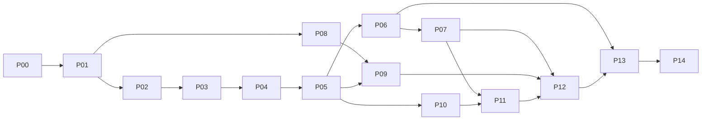

# Roadmap và điều kiện triển khai

Đường triển khai mặc định là P00→P14. Bảng này nêu prerequisite tối thiểu; file phase quy định thứ tự task nội bộ. P00–P14 là work package của bộ plan này, không phải đổi tên Phase 0–4 trong master prompt.

| Phase | File                                                                       | Prerequisite  | Đầu ra chính                             | Mapping master prompt    |
| ----- | -------------------------------------------------------------------------- | ------------- | ---------------------------------------- | ------------------------ |
| P00   | [Baseline](phases/P00-baseline-and-execution.md)                           | Không         | Baseline và test isolation               | Phase 0                  |
| P01   | [Authorization/audit/checkout](phases/P01-authorization-audit-checkout.md) | P00           | Quyền đúng policy, audit, retry checkout | Core prerequisites       |
| P02   | [Capacity/history](phases/P02-driver-capacity-and-history.md)              | P01           | Một chuyến active/Driver; giữ history    | Phase 1                  |
| P03   | [Availability/GPS](phases/P03-availability-and-location.md)                | P02           | Online/ready và latest location          | Phase 1; nền Phase 2     |
| P04   | [Search/offers](phases/P04-assignment-search-and-offers.md)                | P03           | Durable assignment workflow              | Phase 1                  |
| P05   | [Offer/core gate](phases/P05-offer-response-and-core-workflow.md)          | P04           | Accept/reject/retry và 12 core AC        | Phase 1                  |
| P06   | [Tracking/navigation](phases/P06-realtime-tracking-and-navigation.md)      | P05           | Authorized realtime GPS                  | Phase 2                  |
| P07   | [Admin monitoring](phases/P07-admin-monitoring-and-reassignment.md)        | P06           | Monitoring và ngoại lệ trước pickup      | Phase 2; nền Phase 4     |
| P08   | [Restaurant management](phases/P08-restaurant-profile-menus-hours.md)      | P01           | Phone/hours/menu groups/reject           | Phase 3                  |
| P09   | [Inventory](phases/P09-inventory-ledger-and-alerts.md)                     | P08, P05      | Ledger và cảnh báo                       | Phase 3                  |
| P10   | [Proof](phases/P10-delivery-proof.md)                                      | P05           | OTP/ảnh và completion guard              | Phase 3                  |
| P11   | [Support/refund](phases/P11-support-review-failure-refund.md)              | P07, P10      | Complaint, evidence, approval/recovery   | Phase 4; role completion |
| P12   | [Dashboards/earning](phases/P12-dashboards-history-earnings.md)            | P07, P09, P11 | Reports theo role                        | Phase 3; giám sát        |
| P13   | [Strategies](phases/P13-assignment-strategies.md)                          | P06, P12      | Lowest ETA/Balanced Load                 | Phase 3                  |
| P14   | [Final acceptance](phases/P14-resilience-and-final-acceptance.md)          | P01–P13       | Resilience và regression/migration gate  | Phase 4; nghiệm thu      |

P14 có prerequisite tất cả P01–P13; sơ đồ rút gọn cạnh bắc cầu. Không chạy song song task sửa chung schema/ports nếu chưa có phối hợp được người dùng giao. Không tự spawn agent từ bộ tài liệu này.

## Các mốc

- **M0:** P00 xác lập baseline và môi trường kiểm chứng; tạo plan không tự hoàn thành M0.
- **M1:** P05 chứng minh đủ 12 tiêu chí Phase 1. UI monitoring tối thiểu phải có ở P05; P07 chỉ mở rộng bộ lọc/KPI, không dùng để trì hoãn AC core.
- **M2:** P07 có tracking và vận hành ngoại lệ trước pickup.
- **M3:** P08–P13 đóng các khoảng trống role/feature trong demo.
- **M4:** P14 có full regression, migration rehearsal và coverage/evidence đầy đủ.

## Ranh giới chuyển tiếp

P02 tạm giữ gán thủ công để bảo vệ luồng cũ. P03–P04 xây nền phía sau cờ `ASSIGNMENT_AUTOMATION_ENABLED=false`. Chỉ kích hoạt mặc định ở P05 sau khi core tests pass. Từ đó API assign cũ là alias cho ngoại lệ có reason, không còn đường gán thông thường.

Không bootstrap search cho order đang PENDING_PAYMENT/CONFIRMED. Khi kích hoạt P05, bootstrap idempotent các delivery UNASSIGNED thuộc order ACCEPTED/PREPARING/READY_FOR_PICKUP. Delivery đã assigned được giữ; conflict legacy phải qua preflight P02.

Proof được snapshot vào Delivery mới từ khi P10 kích hoạt. Delivery legacy chưa có yêu cầu proof không bị chặn đột ngột. Inventory ledger khởi tạo từ số dư hiện có tại cutover, không dựng lại lịch sử nhập/xuất chưa từng lưu.

Nếu task/phase BLOCKED, dừng phần phụ thuộc và ghi incident. Có thể tiếp tục task độc lập trong phạm vi đã được giao; không coi phase bị chặn là DONE để vượt dependency.
